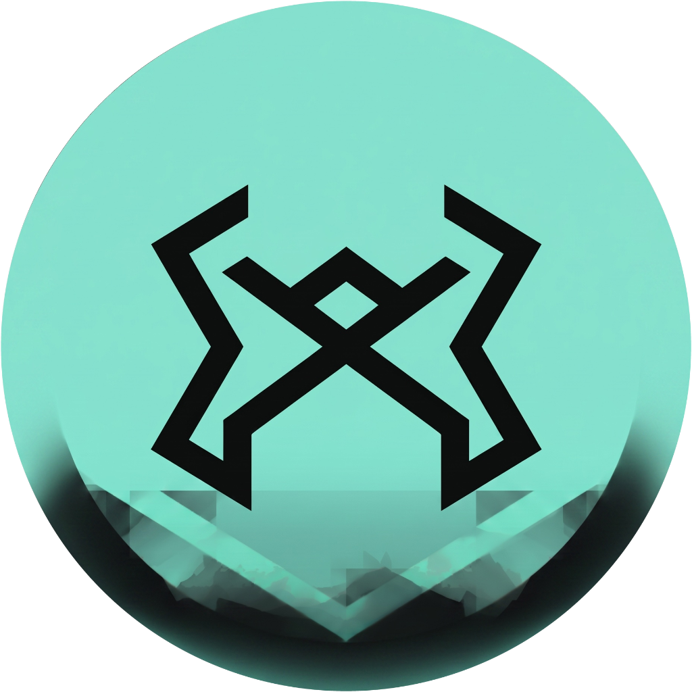
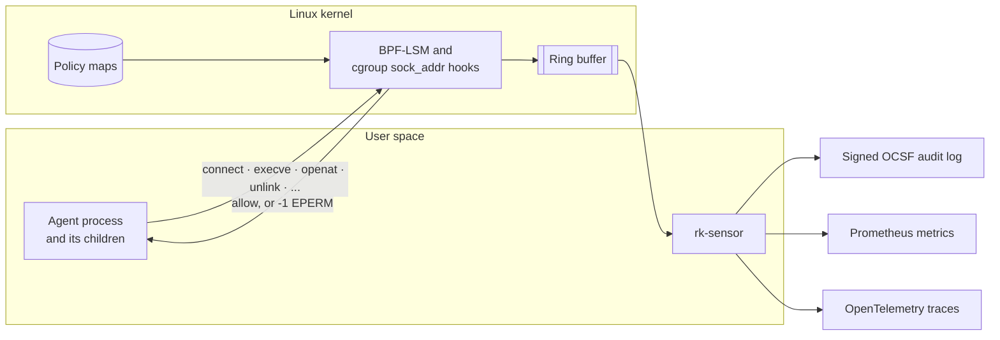
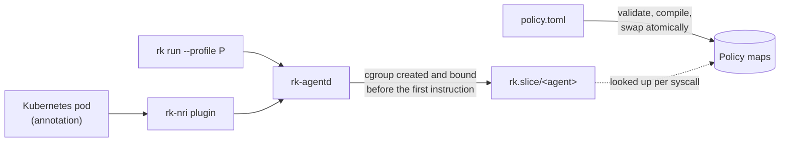

<div align="center">

<p align="center">
  
</p>

# Reality Kernel

### Kernel-level enforcement for AI agents on Linux

Network, exec and file policy decided in the kernel, before the action, with a
signed record of every decision.

[](https://github.com/Keter-Lab/reality-kernel/actions/workflows/ci.yml)
[](https://github.com/Keter-Lab/reality-kernel/actions/workflows/kernel.yml)
[](https://scorecard.dev/viewer/?uri=github.com/Keter-Lab/reality-kernel)
[](https://www.bestpractices.dev/projects/15819)
[](LICENSE)

**[Install](docs/install.md) · [Policy](docs/policy.md) · [Architecture](docs/architecture.md) · [Threat model](docs/threat-model.md) · [Evidence](docs/evidence.md) · [Website](https://realitykernel.dev/)**

</div>

---

AI agents run shell commands, read files and open network connections with
real privileges. Guardrails that inspect prompts or tool calls sit in front of
the agent; a prompt injection, a bug or a child process can step around them.
Reality Kernel puts the decision where it cannot be stepped around: in eBPF
programs attached to the Linux kernel's BPF-LSM and cgroup socket hooks, for
every process in a governed cgroup.

## What it does

Every statement below links to the criterion whose tests prove it, on every
supported kernel, in every CI run ([how this is checked](docs/testing.md)).

<!-- claims:begin -->
- Denies governed network connections in the kernel with `EPERM`, over TCP and UDP, IPv4 and IPv6. [evidence](docs/evidence.md#net-enforce-eperm)
- Closes the usual bypasses: raw and packet sockets, TUN/TAP devices, io_uring, TCP Fast Open and NAT64 addresses. [evidence](docs/evidence.md#net-bypasses) · [evidence](docs/evidence.md#tun-containment)
- Allows only listed executables, decided on file identity rather than path, so symlinks, replaced binaries, scripts and memfd tricks do not get around it. [evidence](docs/evidence.md#exec-allowlist) · [evidence](docs/evidence.md#exec-identity)
- Protects files per access type (read, write, delete, rename, link, create, setattr), whatever name the file is reached by. [evidence](docs/evidence.md#file-access-types) · [evidence](docs/evidence.md#file-identity)
- Governs an agent launched with `rk run` from its first instruction, and every process it starts. [evidence](docs/evidence.md#agent-first-instruction) · [evidence](docs/evidence.md#agent-children)
- Governs Kubernetes pods selected by annotation, through an NRI plugin, from their first instruction. [evidence](docs/evidence.md#k8s-first-instruction)
- Applies policy changes atomically and rolls them back with one command. [evidence](docs/evidence.md#net-atomic-reload) · [evidence](docs/evidence.md#policy-pipeline)
- Offers an audit mode that reports what would be denied without blocking it. [evidence](docs/evidence.md#net-audit)
- Keeps enforcing when the sensor restarts or crashes, and fails closed if it stays down. [evidence](docs/evidence.md#survives-restart) · [evidence](docs/evidence.md#heartbeat-fail-closed)
- Denies governed workloads the means to tamper with it: `bpf()`, signals, ptrace and removing its pins. [evidence](docs/evidence.md#self-protection)
- Upgrades without a protection gap, even when the kernel programs change. [evidence](docs/evidence.md#upgrade_continuous)
- Records every deny and audit-would-deny in a signed, hash-chained OCSF audit log, and detects tampering with it. [evidence](docs/evidence.md#audit_complete) · [evidence](docs/evidence.md#audit_tamper) · [evidence](docs/evidence.md#ocsf_schema)
- Exports Prometheus metrics and OpenTelemetry traces linking agent sessions to their kernel decisions. [evidence](docs/evidence.md#metrics) · [evidence](docs/evidence.md#otlp)
- Says plainly when the kernel lacks BPF LSM, and refuses the rules it could not enforce instead of pretending. [evidence](docs/evidence.md#capability-honesty)
- Measures its per-hook overhead in CI and fails the build when it exceeds the budget. [evidence](docs/evidence.md#perf-gate) · [evidence](docs/evidence.md#perf-reported)
<!-- claims:end -->

## How it works

A governed workload makes a system call. An eBPF program attached to the
kernel decides it against the compiled policy, before the action happens, and
the decision streams to the audit log. The verdict never waits for userspace.



A workload becomes governed when it is placed in a cgroup bound to a profile:



Kernel programs are C with libbpf CO-RE, loaded by a Rust sensor that pins
them so they keep enforcing when it restarts. Details:
[architecture](docs/architecture.md), [decisions](docs/decisions/README.md),
[design notes](docs/design/).

## Example

A profile that lets a research agent reach one internal network over HTTPS,
run Python and git, and never touch its SSH keys:

```toml
[profiles.research-agent]
mode = "enforce"               # start with "audit" to see what would be denied
network.default = "deny"

[[profiles.research-agent.network.allow]]
cidr = "10.20.0.0/16"
ports = ["443"]
proto = ["tcp"]

[profiles.research-agent.exec]
allow = ["/usr/bin/python3", "/usr/bin/git"]

[[profiles.research-agent.files.deny]]
path = "/home/agent/.ssh"
subtree = true
access = ["all"]
```

What the agent sees, and what the host records:

```console
$ rk run --profile research-agent -- python3 agent.py
  # inside the agent: connect(... 203.0.113.7:443 ...) = -1 EPERM

$ rk audit tail --verdict deny --session s-81
2026-10-23T09:14:02.118Z DENY   Open 203.0.113.7:443/tcp  rule 4 (research-agent) gen 3  pid 4312 /usr/bin/python3  session s-81

$ rk audit verify --pubkey /var/lib/rk/audit.key.pub
VERIFIED
```

The full policy language is in the [policy reference](docs/policy.md), and the
record format in [docs/audit.md](docs/audit.md).

## Quick start

On a host with kernel 5.15 or newer:

```sh
curl -fsSL https://realitykernel.dev/install.sh | sh   # verifies the checksum, and the signature with cosign
sudo rk init                                           # a starter profile in AUDIT: records, blocks nothing
rk run --profile agent -- python3 agent.py             # governed from its first instruction
sudo rk policy suggest --profile agent --out agent.toml  # an ENFORCE profile from what it did; review it
rk audit tail -f                                       # what it decided, as it happens
```

Or hand the whole setup to your coding agent: [docs/agents.md](docs/agents.md)
is a runbook it can follow, with a prompt to paste. `rk init` and
`rk policy suggest` need v0.2.0 or later; with v0.1.0, write the profile by
hand ([docs/policy.md](docs/policy.md)).

Kubernetes: the Helm chart in [`deploy/helm/reality-kernel`](deploy/helm/reality-kernel)
runs the sensor as a DaemonSet with the NRI plugin. Full guide:
[docs/install.md](docs/install.md).

Releases are signed with Sigstore and carry SLSA provenance and an SBOM;
[how to verify one](docs/releases.md#verifying-a-release).

## Supported kernels

| Kernel | Enforcement tested in CI |
|---|---|
| 5.15 LTS (minimum) | network, exec, files, self-protection |
| 6.1 LTS | network, exec, files, self-protection |
| 6.6 LTS | network, exec, files, self-protection |
| 6.12 LTS | network, exec, files, self-protection |
| 6.18 | network, exec, files, self-protection |

Exec, file and self-protection rules need BPF LSM (`lsm=...,bpf`); without it
only network rules are enforced, and `rk doctor` says so. The kernel suites run
on x86_64; arm64 is built and unit-tested. Details:
[docs/kernel-matrix.md](docs/kernel-matrix.md).

## Documentation

| | |
|---|---|
| [Set up with a coding agent](docs/agents.md) | `install.sh`, `rk init`, `rk policy suggest`, step by step |
| [Install, upgrade, remove](docs/install.md) | packages, systemd, Kubernetes, `rk doctor` |
| [Policy reference](docs/policy.md) | profiles, network, exec, files, bindings, rollout |
| [Audit log](docs/audit.md) | format, verification, OCSF fields |
| [Architecture](docs/architecture.md) and [ADRs](docs/decisions/README.md) | how it is built and why |
| [Threat model](docs/threat-model.md) | what it protects against, and what it does not |
| [Roadmap](ROADMAP.md) | what comes next, by release |
| [Hardening](docs/hardening.md) | host settings that matter |
| [Testing](docs/testing.md) and [evidence](docs/evidence.md) | how every claim is tested |
| [Releases](docs/releases.md) and [changelog](CHANGELOG.md) | versioning, support window, verifying artifacts |

## Contributing and security

Contributions are welcome: start with a
[good first issue](https://github.com/Keter-Lab/reality-kernel/issues?q=is%3Aopen+label%3A%22good+first+issue%22)
and [CONTRIBUTING.md](CONTRIBUTING.md#your-first-contribution) (commits are
signed off under the [DCO](https://developercertificate.org/)),
[GOVERNANCE.md](GOVERNANCE.md). Open work is on the
[project board](https://github.com/orgs/Keter-Lab/projects/1), and larger
project ideas are in [docs/gsoc.md](docs/gsoc.md). Report vulnerabilities privately as described in
[SECURITY.md](SECURITY.md).

Reality Kernel began as a hosted API service; that product, its SDK and its
analysis engine are retired ([ADR-0016](docs/decisions/0016-retire-the-hosted-product.md)).

## License

Userspace code is dual-licensed under [Apache-2.0](LICENSE-APACHE) or
[MIT](LICENSE-MIT), at your option. The BPF programs in `rk-bpf/` are dual
[GPL-2.0-only](LICENSE-GPL-2.0) or MIT
([ADR-0012](docs/decisions/0012-bpf-licensing.md)). See [LICENSE](LICENSE).
